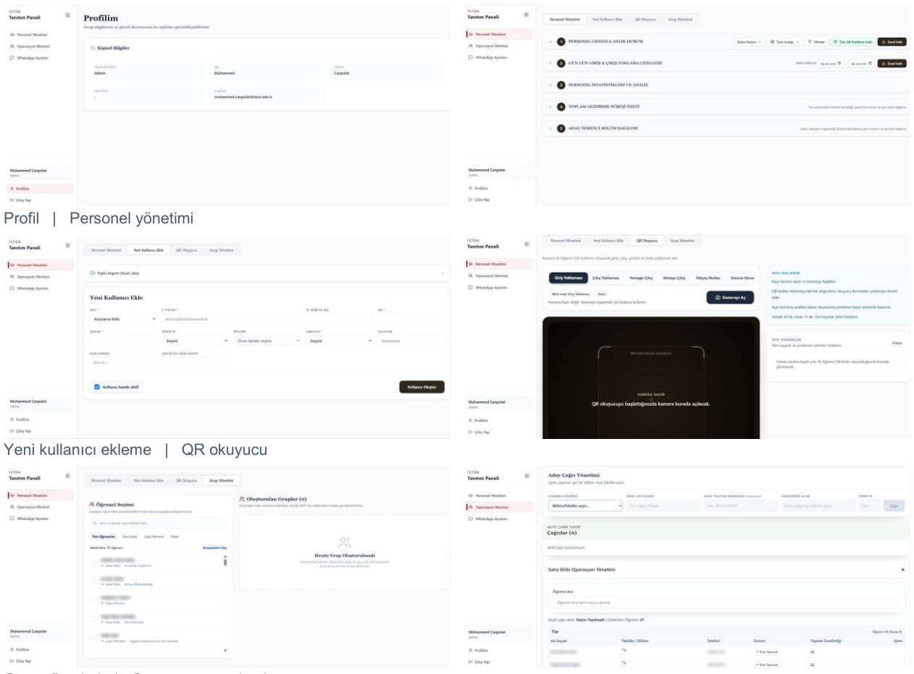
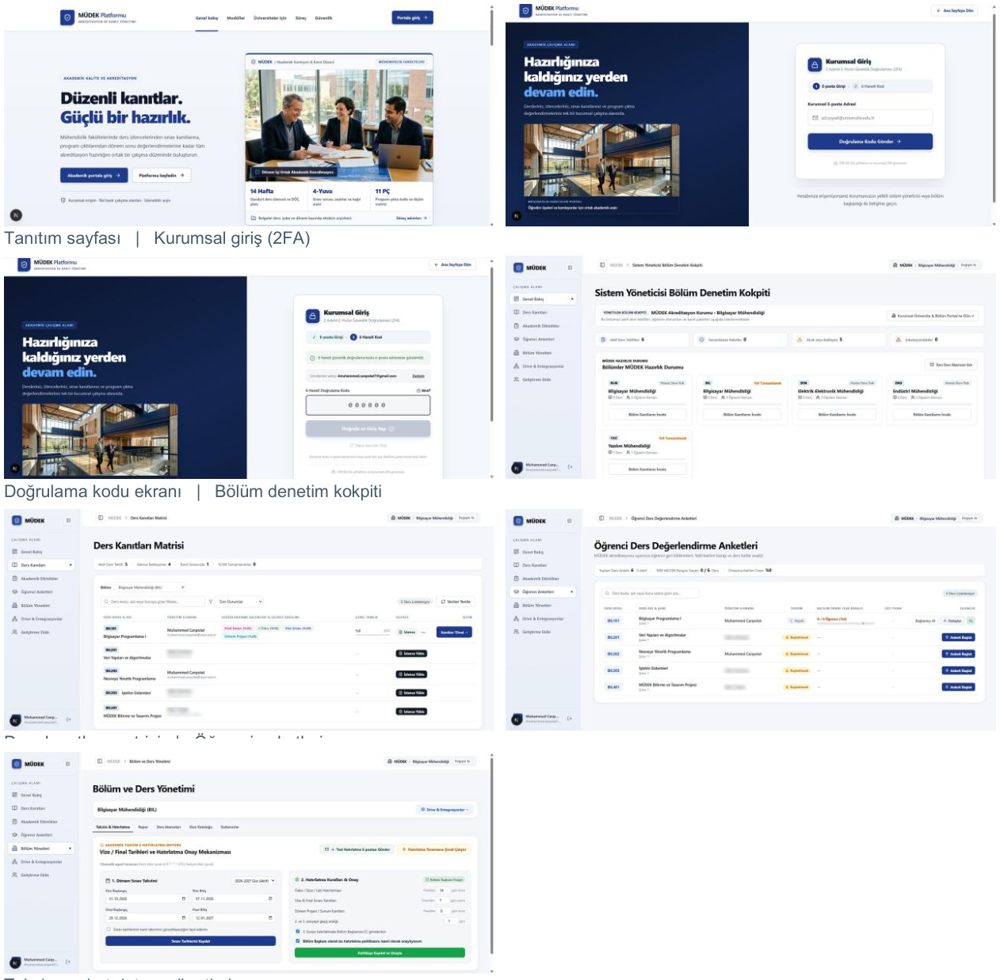
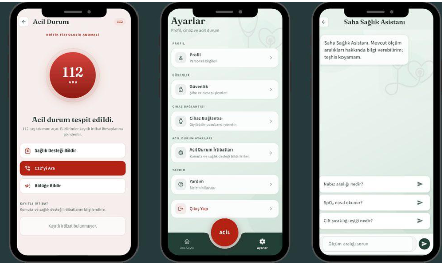
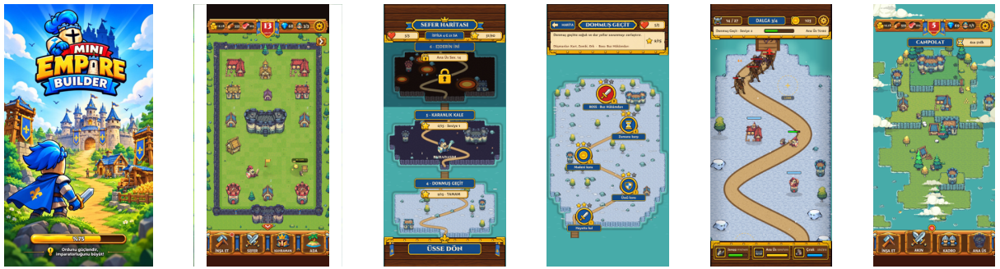
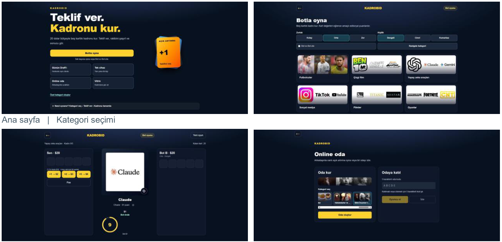
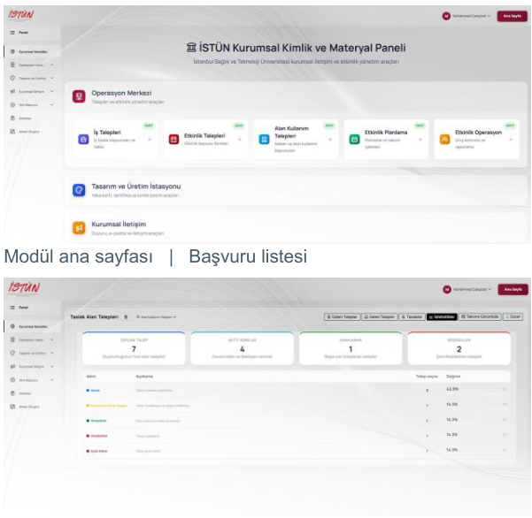

# Hi, I'm Muhammed Canpolat 

**Software Development · Full-Stack · Game Development · IoT**

[LinkedIn](https://www.linkedin.com/in/muhammed-canpolat/)

Building practical software across **web, mobile, IoT, and interactive games**.

## About me

I'm a fourth-year Computer Engineering student based in Istanbul, Türkiye. I've worked on institutional web platforms, real-time management systems, hardware testing, and research-oriented IoT applications. I also develop games with Unity and C#.

- 💻 **Software engineering:** Full-stack applications, database-backed systems, administrative tools
- 🎮 **Game development:** Unity/C# gameplay systems and strategy-game mechanics
- 🔬 **Research & IoT:** Team lead on a TÜBİTAK 2209-A-supported wearable health-monitoring project
- 🛠️ **Hardware:** Hands-on R&D testing and system diagnostics experience

## Technologies

**Web** · Next.js, React, TypeScript, JavaScript, PHP, Tailwind CSS

**Game development** · Unity, C#

**Mobile & IoT** · Flutter, Dart, ESP32, Arduino

**Data & tools** · Supabase, MySQL, Firebase, Docker, Git

**Also used:** Python, Java, C, C++, HTML/CSS, VS Code

## Selected projects

### University Operations & Management Platform
**Institutional project · Deployed and used**  
**Next.js · TypeScript · Supabase Realtime · Docker**

A real-time management platform for university promotional events, supporting four personnel roles, QR-based attendance, live staff coordination, automatic queue rotation, and XLSX reporting. Source code and internal access are not publicly shared.

View screenshots

### MÜDEK Accreditation & Evidence Management Portal
**Institutional project**  
**Next.js · TypeScript · tRPC · MySQL · Google Drive**

A role-based academic accreditation portal with email-code two-step sign-in, evidence tracking, Google Drive integration, scheduled reminders, and departmental dashboards. Source code and internal access are not publicly shared.

View screenshots

### SENS-AI — Wearable Health Monitoring
**TÜBİTAK 2209-A-supported research · Team lead**  
**Flutter · ESP32 · Firebase Realtime Database**

A wearable-sensor and mobile-app system for real-time physiological monitoring. I worked on device-to-app communication, sensor integration, system architecture, and team coordination. Research from this project received paper acceptances at **ICSET-25** and **SAVTEK 2026**.

View screenshots

### Mini Empire Builder
**Personal project · Android-oriented 2D strategy game**  
**Unity · C#**

A strategy game featuring base building, resource economy, offline gold generation, region-based campaigns, and wave-based combat with multiple enemy and boss types.

View screenshots

### Kadrobid — Multiplayer Auction & Draft Game
**Personal project**  
**Next.js · Supabase**

A real-time multiplayer draft game with fixed-budget bidding, player and spectator rooms, local multiplayer, and configurable bot strategies.

View screenshots

### Internal Space Reservation System
**Institutional project · Completed, not deployed**  
**PHP · JavaScript · HTML/CSS · MySQL**

A full-stack reservation platform with calendar availability, multi-step requests, draft saving, administrative approval, statistics, and Excel export. Not deployed due to institutional procedures.

View screenshots

## Research highlights

- **TÜBİTAK 2209-A:** Supported undergraduate research project; team lead
- **ICSET-25:** Research paper acceptance on real-time IoT-based health monitoring
- **SAVTEK 2026:** Research paper acceptance on wearable physiological monitoring and anomaly detection

## Connect
- [Email](mailto:4muhammed.canpolat7@gmail.com)

> Some institutional projects are described without publishing proprietary source code, internal links, or sensitive data.
